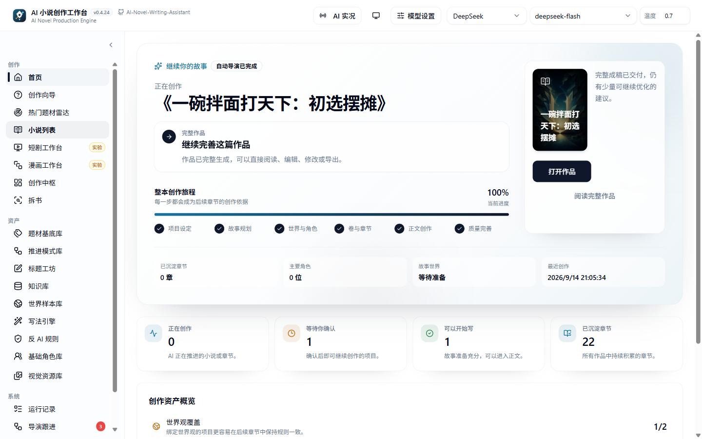
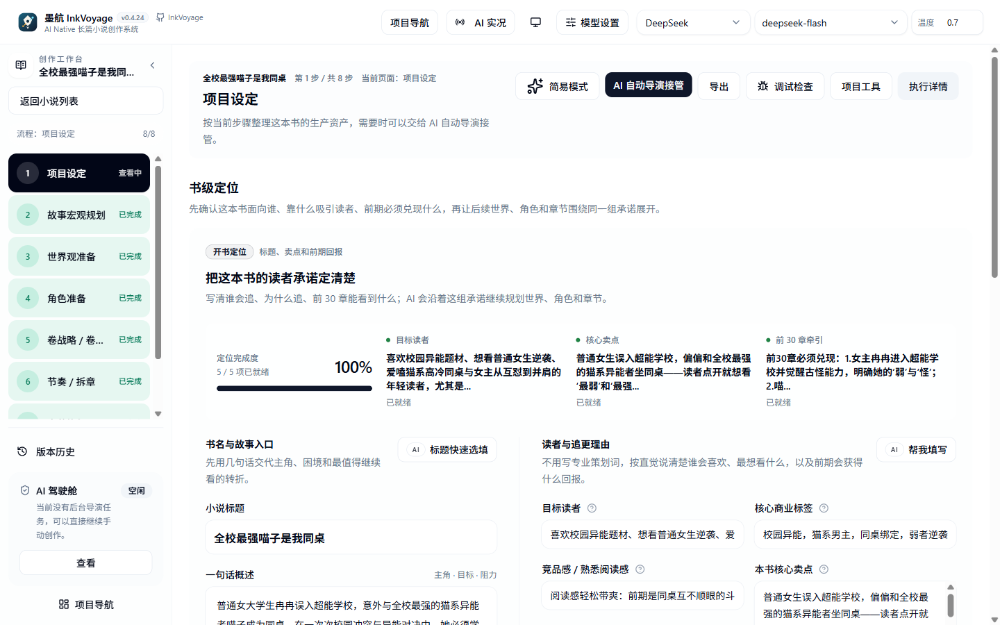
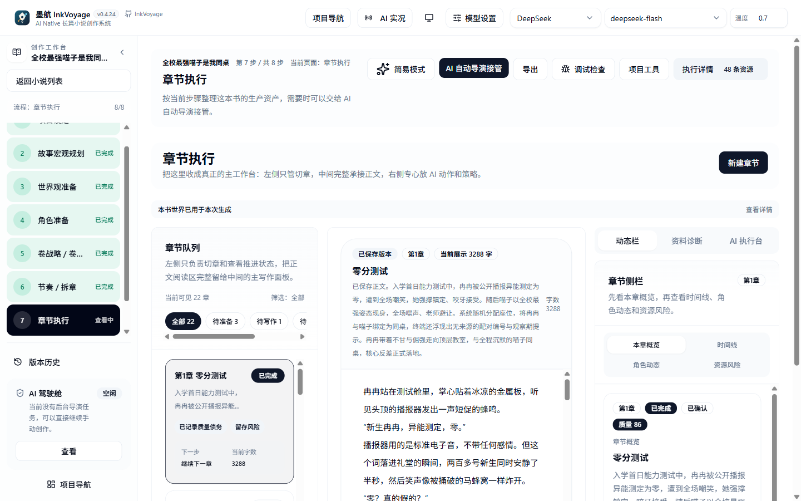
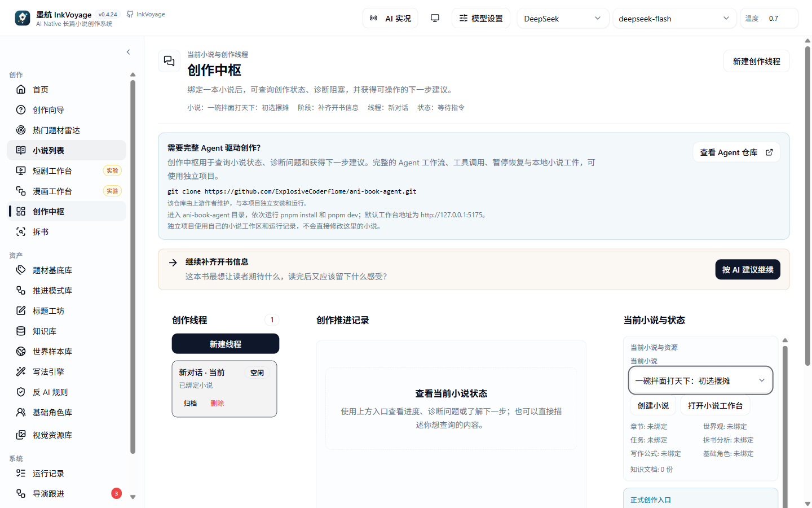
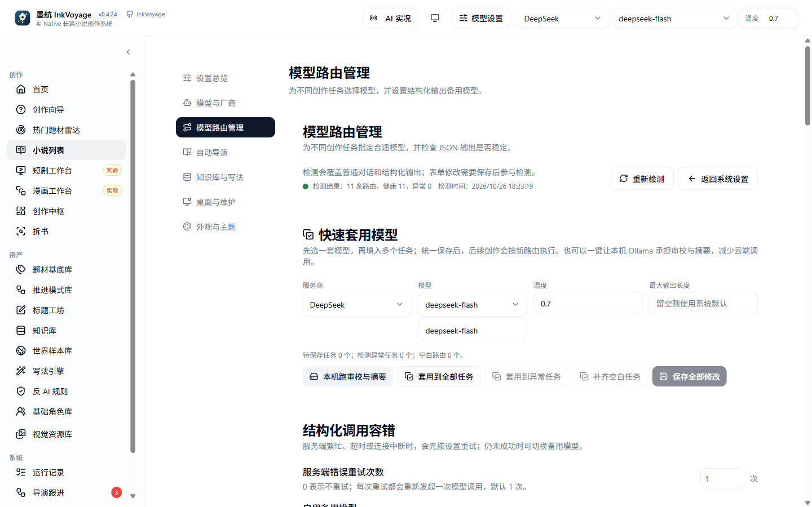
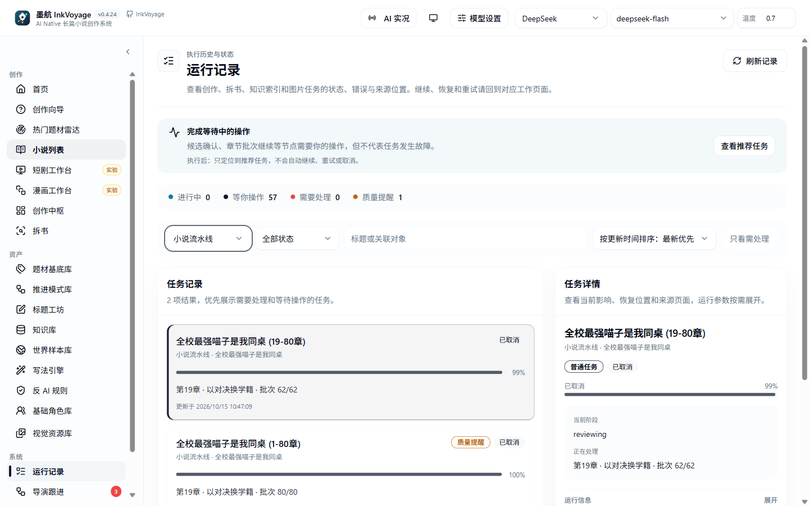
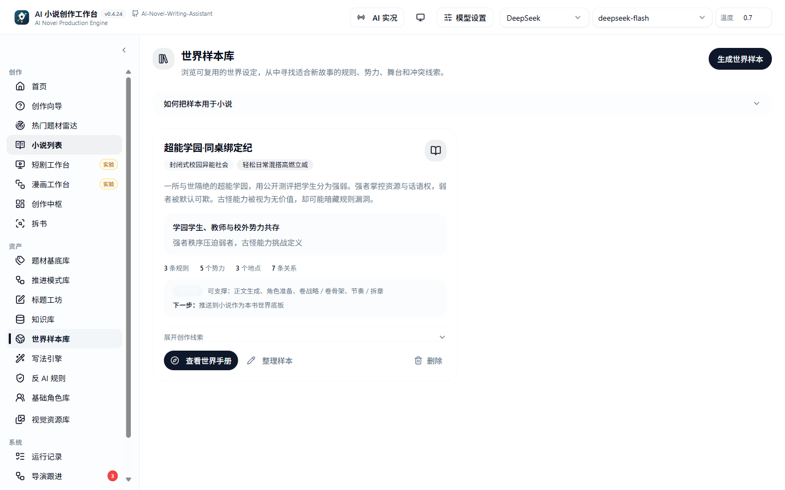

# 墨航 InkVoyage

**一个面向长篇小说的 AI Native 生产系统。**  
不是"你写一句、AI 补一句"的聊天壳子，而是把开书、规划、章节生产、审核修复和长篇记忆串成一条可恢复的创作链。


## 这是什么

墨航 InkVoyage 是一个**个人开源项目**，目标很具体：帮助完全不懂写作的新手，从一个灵感走到一本完整的长篇小说。

它和普通 AI 写作工具的区别在于：

- **以"整本完成"为目标**，不是只生成单章或单段文案；
- **AI 参与规划、调度、审核和修复**，而不只是补全文字；
- **所有创作状态可保存、可恢复、可追溯**，长任务可以暂停、继续和换模型重试；
- **长篇一致性是一等公民**：世界规则、角色状态、伏笔账本、时间线和分层摘要会持续进入后续章节上下文。

项目同时是作者的**技术学习与作品集**：完整展示一个 AI Native 应用如何把 Agent Workflow、RAG、结构化生成和长链路任务恢复落到真实创作业务里。

## 核心能力

- **从一句灵感开书**：自动导演先整理书级方向、世界、角色、卷章规划，推进到可开写，再由你选择简易创作或专业创作。
- **整本生产主链**：章节生成 → 审核 → 修复 → 保存 → 状态回灌 → 下一章，支持断点恢复和人工接管。
- **长篇记忆与一致性**：伏笔账本、角色资源账本、角色弧线、全书时间线快照、连续性守卫和 RAG 召回共同约束后续生成。
- **创作资产库**：拆书、知识库、写法引擎、世界样本、题材基底、推进模式、角色库和反 AI 规则都可沉淀、复用、参与生成。
- **质量与成本可观察**：生产看板（章节状态 / 质量债务 / 卷进度 / 成本与预算）、章节生成 Trace、失败恢复知识库、任务运行记录。
- **可视化工作台**：故事世界图谱、故事时间线、自动导演步骤图、章节紧张度曲线和统计图表。
- **模型自由**：多提供商、按任务路由、成本对比、本机 Ollama 跑审校与摘要。
- **实验特性收束**：漫画与短剧工作台作为实验特性保留，可隐藏入口；短剧视频成片明确为模拟演示。

## 适合谁

| 适合 | 不适合 |
| --- | --- |
| 想写完第一本长篇小说、但不懂结构和节奏的新手 | 只想要一个通用 AI 聊天工具的人 |
| 想研究 AI Native 产品、Agent Workflow、LangGraph 编排的开发者 | 需要成熟商业级 SaaS 或多租户团队协作的场景 |
| 想在自己的机器上私有运行、自己掌控模型和数据的人 | 不愿配置模型 API 或本地环境的用户 |

## 界面预览

### 首页：继续你的故事



### 小说工作台：从项目设定到章节执行





### 创作中枢与模型路由





### 运行记录与创作资产






## 快速开始

### 环境要求

- Node.js `^20.19.0 || ^22.12.0 || >=24.0.0`（推荐 `20.19.x LTS`）
- pnpm `>= 10.6`（仓库声明 `pnpm@10.6.0`）
- 一组可用的 LLM API Key（也可以先启动，再在页面里配置）
- 可选：Qdrant（仅在启用知识库 / RAG 时需要）

### 安装与启动

```bash
pnpm install
cp server/.env.example server/.env   # Windows PowerShell: Copy-Item server/.env.example server/.env
pnpm dev
```

默认地址：

| 服务 | 地址 |
| --- | --- |
| 前端 | http://localhost:5173 |
| 后端 | http://localhost:3000 |
| API | http://localhost:3000/api |

首次启动服务端会自动执行 Prisma generate 和 `db push`，通常不需要手动迁移。前端开发模式默认把 API 指向当前 hostname 的 `:3000`，同机或局域网访问通常不需要创建 `client/.env`。

### 第一次使用

1. 打开 `http://localhost:5173/settings`，配置至少一组模型供应商和默认模型。
2. 打开 `/settings/model-routes`，按需为规划、正文、审校、摘要等任务分配模型（也可以先用默认模型跑通）。
3. 需要知识库时，到 `/knowledge?tab=settings` 配置 Embedding 与集合；不接知识库可在 `server/.env` 设置 `RAG_ENABLED=false`。
4. 回到首页或创作向导，输入一句灵感，跟随自动导演完成开书和第一章。

更完整的安装、Qdrant 配置和排障说明见 [安装与准备](./docs/public/installation.md) 与 [使用方法](./docs/public/usage-guide.md)。

## 常用命令

```bash
pnpm dev              # 启动 shared / server / client
pnpm dev:stop         # 停止本地开发进程并释放 3000 / 5173
pnpm build            # 生产构建
pnpm typecheck        # 全仓类型检查
pnpm test             # 后端快速测试
pnpm test:all         # 后端快速 + 集成 + 客户端测试
pnpm dev:site         # 公开介绍站（:4173）

# 仅在开发 / 调整 Prisma schema 时使用
pnpm db:migrate
pnpm db:seed
pnpm db:studio

# 桌面打包（仅发布时使用）
pnpm stage:desktop
pnpm dist:desktop:nsis
pnpm dist:desktop:portable
```

## 技术栈与仓库结构

| 层级 | 技术 |
| --- | --- |
| 前端 | React 19、Vite、React Router、TanStack Query、Plate、Tailwind CSS |
| 后端 | Express 5、Prisma、Zod |
| AI 编排 | LangChain、LangGraph、结构化输出与 Prompt Registry |
| 数据 | SQLite（默认）、Qdrant（可选 RAG） |
| 工程形态 | pnpm workspace Monorepo |

```text
client/   React + Vite 前端
server/   Express + Prisma + Agent Runtime + 自动导演 + 章节生产
shared/   前后端共享类型与协议
desktop/  Electron 桌面壳
site/     公开介绍站与文档站
docs/     公开文档、设计、wiki、计划与发布历史
images/   README 与公开文档截图
```

更细的模块边界与架构决策见 [docs/wiki/](./docs/wiki/README.md)，文档分区见 [docs/README.md](./docs/README.md)。

## 当前状态与路线图

- 接手后的系统性改进已完成一轮（LOOP-1 ~ LOOP-63）：主链稳定性、测试基线、重构、UI、文档和开源就绪均已收口。
- 当前验证基线：server 全量 **1484 / 1472 过 / 0 失败 / 12 跳过**；client **283/283**；三端 typecheck 通过。
- 当前优先级与中期方向见 [TASK.md](./TASK.md)；公开路线图见 [开发计划](./docs/public/development-roadmap.md)。
- 已知收尾项：部分公开文档截图仍需在示例数据环境补拍（UI-8）。

## 文档

- **公开文档**：[安装与准备](./docs/public/installation.md)、[使用方法](./docs/public/usage-guide.md)、[常见问题](./docs/public/faq.md)、[故障排查](./docs/public/troubleshooting.md)
- **生产链深度文档**：[端到端生产链](./docs/public/flow/end-to-end-production.md)、[自动导演阶段全景](./docs/public/flow/auto-director-pipeline.md)、[章节执行链](./docs/public/flow/chapter-execution.md)、[知识与 RAG](./docs/public/flow/knowledge-and-rag.md)
- **实操路径**：[第一本小说实操路径](./docs/public/playbook/first-novel-walkthrough.md)、[按阶段恢复手册](./docs/public/playbook/recovery-by-phase.md)
- **开发知识库**：[docs/wiki](./docs/wiki/README.md)（架构、工作流、Prompt、RAG、调试、产品规则）
- **完整更新历史**：[docs/releases/release-notes.md](./docs/releases/release-notes.md)

## 贡献与反馈

欢迎通过 [GitHub Issues](https://github.com/Second123666/AI-novel/issues) 反馈问题、交流使用体验，或讨论自动导演、章节生产、写法引擎等方向。

提交 Pull Request 即表示你确认自己有权提交该内容，并已阅读且同意 [CLA.md](./CLA.md)；如果包含第三方代码、素材、AI 生成内容或其他受许可证约束的内容，请在 PR 中明确说明来源和许可证。详见 [CONTRIBUTING.md](./CONTRIBUTING.md)。

仓库国内镜像：[Gitee · secondkiller/ai-novel](https://gitee.com/secondkiller/ai-novel)。

## 相关项目

- [Ani Book Skill](https://github.com/ExplosiveCoderflome/ani-book-skill)：上游作者维护的 Codex Skill，提供另一条本地文件式的长篇创作路径，与本项目互补。

## License

本项目基于 **GNU Affero General Public License v3.0 only (AGPL-3.0-only)** 授权，详见 [LICENSE](./LICENSE)；归属与衍生说明见 [NOTICE](./NOTICE)。

- 本项目是上游 `AI-Novel-Writing-Assistant` 的独立衍生版本，上游版权声明与许可条款保留；本仓库的修改与新贡献归当前维护者与贡献者。
- 商业合作可以联系项目维护者，但开源许可不因商业合作而改变；使用、修改或分发本项目时，请遵守 AGPL-3.0-only。
- 第三方组件与素材许可见 [THIRD_PARTY_NOTICES.md](./THIRD_PARTY_NOTICES.md)。
- 新贡献默认按 [CLA.md](./CLA.md) 提交，并随项目按 AGPL-3.0-only 分发。

## 最新更新

### 2026-10-28

#### 优化

- 桌面版统一使用「墨航 InkVoyage」应用身份：安装包、快捷方式、数据目录和图标更新为新品牌；首次启动会自动复制旧版本地数据，旧数据保留。
- Windows 安装包和便携版使用 InkVoyage 文件名，桌面与开始菜单快捷方式显示「墨航 InkVoyage」。
- 桌面、浏览器和项目介绍站统一使用新的「墨帆」图标。

完整历史更新见 [docs/releases/release-notes.md](./docs/releases/release-notes.md)。

## 致谢

感谢上游项目 [AI-Novel-Writing-Assistant](https://github.com/ExplosiveCoderflome/AI-Novel-Writing-Assistant) 及其贡献者，以及为本项目提交修复的贡献者。
